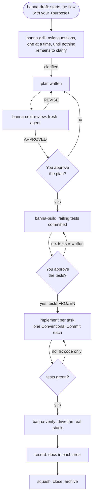

<div align="center">

# Banna · بنّا


*Plan → Test → Code → Record: cold plan review, frozen tests, and knowledge written next to the code.*

[](https://github.com/vercel-labs/skills)
[](#the-skills)
[](LICENSE)

</div>

---

Agents write code faster than you can review it. Plans go in unreviewed, tests get written after the code they claim to test, and design decisions live in a chat log nobody reads again.

**Banna** (Persian for *builder*) is a set of agent skills that runs the boring, correct loop instead: clarify the goal, draft a plan, review it cold, write failing tests, freeze them, implement task by task, verify on the real stack, and record what you learned next to the code it belongs to.



Every step is a skill your agent already knows how to run. You approve three things: the plan, the frozen tests, and the finished work.

## Quickstart

Requires [Node.js](https://nodejs.org) 22.20+ and an agent that supports
[Agent Skills](https://agentskills.io) (Claude Code, Codex, Cursor, OpenCode, ZCode, and many more).

```bash
npx skills add hosseinhabibi2004/banna
```

Once per project:

```
/banna-init      # scaffold .banna/config.yaml - asks about your areas, test commands, and agent
```

Then every change runs the same two commands:

```
/banna-draft <purpose>  # starts the flow: grills you until everything is clear, then drafts the plan
/banna-build            # executes the approved plan: red tests -> freeze -> code -> verify -> record
```

The loop is two commands, and the agent does the rest under the rules you configured. banna-init is setup, not part of the loop.

## The skills

| Skill | Role |
|---|---|
| [`banna-init`](skills/banna-init/) | One-time setup — scaffold `.banna/config.yaml` + folders into a project |
| [`banna-draft`](skills/banna-draft/) | Start of the flow: grill, draft an execution-ready plan, rate each task (S/M/L), assign its model |
| [`banna-grill`](skills/banna-grill/) | The interview inside banna-draft: one question at a time until every decision is settled; also runs standalone |
| [`banna-cold-review`](skills/banna-cold-review/) | Cold review of the plan by a fresh agent — APPROVE / REVISE |
| [`banna-build`](skills/banna-build/) | Execute the approved plan: red tests, freeze, per-task commits, verify, record |
| [`banna-handoff`](skills/banna-handoff/) | Park out-of-scope work as a written handoff instead of scope creep |
| [`banna-archive`](skills/banna-archive/) | Sweep finished plans and handoffs into monthly archives |
| [`banna-commit`](skills/banna-commit/) | Conventional Commits grouped by concern |
| [`banna-squash-commit`](skills/banna-squash-commit/) | Collapse a run's commits into one per feature — tree-identical, proven |
| [`banna-verify`](skills/banna-verify/) | Drive the real stack and verify the affected workflow — the gate, not a nicety |

## What it enforces

### Tests freeze once you approve them

banna-build commits failing tests first. You review and approve them; from that moment they do not change. A failing test means fix the code. Changing a frozen test takes your explicit approval and a separate `test(amend)` commit.

### Every task runs on the model its difficulty needs

The draft rates each task S / M / L (mechanical, default, hard) and the config decides which model each stage may use. The catalog in the config names the models of whichever agent runs the repo; the ids are yours to fill in. Mechanical work runs on the cheapest model that can do it. After two identical failures the task moves up one tier and root-cause analysis runs in place of another retry.

### Review is cold

A fresh agent with no stake in the plan checks it: every named skill, file, and model must actually exist in the repo before you see APPROVE.

### Knowledge lands next to the code

ADRs, conventions, the domain glossary, and stack notes are recorded in each area's own `docs/` (the API's invariants in `api/docs/`, the frontend's in `web/docs/`), indexed from a one-line-per-doc `AGENTS.md` per area. Only cross-service facts go to the repo root.

### Plans are files, not chat

One self-contained plan file per change under `.banna/plans/` with a never-reused id (`2026-11-13-001`), archived by month when done. Out-of-scope ideas become handoff files, not bigger plans.

The main session cannot change its own model. It coordinates; each task's work runs in a subagent on the model the plan assigned. If the session model is weaker than what the plan needs and `selection.enforcement` is `stop`, banna-build stops and says so.

## Configuration

Everything is driven by one file. The skills read it at startup and stop if it is missing:

```yaml
areas:
  api:  { code: api/,  docs: api/docs }
  web:  { code: web/,  docs: web/docs }

selection:
  available: [haiku, sonnet, opus]  # model ids from your agent's catalog
  prefer: cheapest                  # cheapest | strongest
  escalate_on_failure: true

tests:
  freeze: true
  commands:
    api: "cd api && pytest"
    web: "cd web && pnpm test"
```

`/banna-init` writes it for you based on what it finds in your repo. See
[`skills/banna-init/config-template.yaml`](skills/banna-init/config-template.yaml) for
the full annotated file: model catalog, per-stage model rules, the difficulty rubric,
freeze and archive policy.

## Repository layout

```
skills/           one folder per skill - SKILL.md + templates + scripts, Agent Skills format
AGENTS.md         conventions for working on the skills in this repo
```

Skills install into the agent's own skills directory (`.agents/skills/` for Claude Code
and most others) and run entirely inside your project. Banna adds no daemon, no CLI, and
no network service. The only files it ever writes are plans, handoffs, docs, and code
you approved.

## Credits

The base workflow is the `plan-*` skills from
[vanenshi/skills](https://github.com/vanenshi/skills). I have worked with it on real
projects, fixed its problems, and made the flow more effective.

## License

[MIT](LICENSE)
